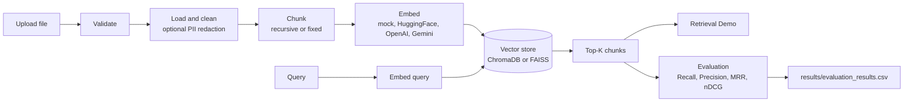
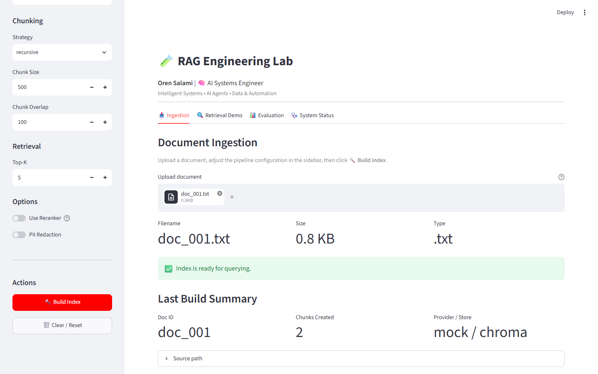
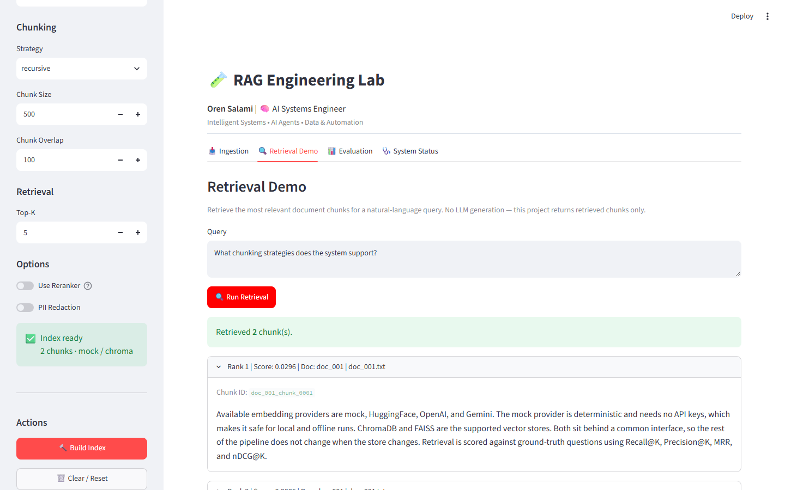
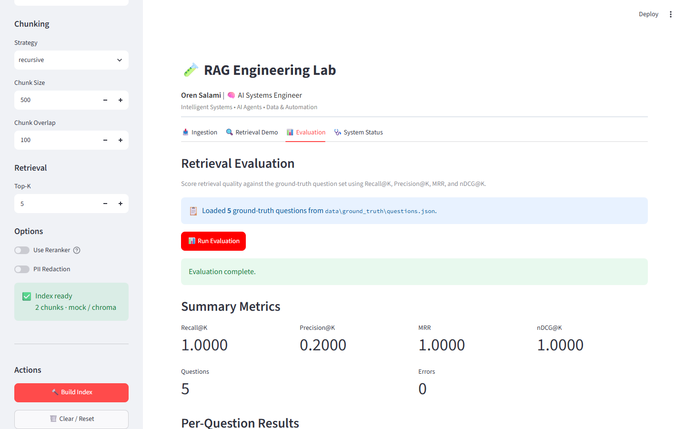

# RAG Engineering Lab

**Oren Salami** | AI Systems Engineer

A local Streamlit lab for building and evaluating the **retrieval** layer of a RAG system. Upload a document, choose how it is chunked, embedded, and stored, then query it and score retrieval quality against a ground-truth question set.

The lab returns retrieved chunks. It does not call an LLM to generate answers.

---

## What

The lab lets you change one retrieval setting at a time and see the effect:

- **Ingestion** of PDF, TXT, Markdown, and HTML files, with text cleaning and optional PII redaction.
- **Chunking** with a recursive or a fixed-size strategy, plus configurable chunk size and overlap.
- **Embeddings** from four providers: `mock` (deterministic, offline), `huggingface` (local sentence-transformers models), `openai`, and `gemini`. OpenAI and Gemini need API keys.
- **Vector stores**: ChromaDB or FAISS, both behind the same interface.
- **Retrieval** of the top-K chunks for a query. Each result shows its rank, score, doc ID, chunk ID, and source file.
- **Evaluation** against `data/ground_truth/questions.json` using Recall@K, Precision@K, MRR, and nDCG@K. Results can be exported to CSV.
- **System status**: the active configuration, runtime metrics (counts and latencies), and basic health checks.
- **Input safety**: file type and size validation, query validation, and a warning when a query looks like a prompt-injection attempt.

## Why

When retrieval returns the wrong context, the generated answer is wrong too, and you often can't tell which happened from the final output alone. This lab separates retrieval from generation so you can answer questions like these:

- How do chunk size and overlap change what gets retrieved?
- Does recursive chunking beat fixed-size chunking on the same document?
- How much does the embedding model matter compared with the vector store?
- Did the relevant document make it into the top K, and how high did it rank?

Mock mode lets the whole pipeline run with no API keys and no model downloads, so you can explore and test the plumbing locally for free.

## How



`RAGPipeline` (`src/pipeline/rag_pipeline.py`) wires these steps together. It holds one embedding provider instance and uses it both for indexing and for queries, so the document and query vectors always come from the same model. Each build indexes a single uploaded document and replaces the previous index in the session.

Evaluation compares the doc IDs of retrieved chunks with the `relevant_doc_id` of each question. A document's doc ID is its filename stem, lowercased (for example, `doc_001.txt` becomes `doc_001`).

---

## Screenshots

These were captured from the running app in mock mode, using a short synthetic sample document.

**Ingestion:** upload a file and build the index.



**Retrieval Demo:** ranked chunks for a query.



**Evaluation:** summary metrics over the ground-truth questions.



---

## Setup

The Docker image uses Python 3.11.

```bash
git clone https://github.com/Oren1984/RAG-Engineering-Lab.git
cd RAG-Engineering-Lab

python -m venv .venv
# Windows:      .venv\Scripts\activate
# macOS/Linux:  source .venv/bin/activate

pip install -r requirements.txt
cp .env.example .env
```

The defaults in `.env.example` run in mock mode and need no API keys. To use OpenAI or Gemini embeddings, set `OPENAI_API_KEY` or `GEMINI_API_KEY` in `.env`. See [docs/API_KEYS_GUIDE.md](docs/API_KEYS_GUIDE.md).

`requirements.txt` includes `sentence-transformers`, which pulls in PyTorch, so the first install can take a while.

### Run locally

```bash
streamlit run app/streamlit_app.py
```

Open http://localhost:8501.

### Run with Docker

```bash
docker compose up --build
```

Open http://localhost:8511 (Compose maps host port 8511 to container port 8501). Compose reads `.env`, so create it first. `data/`, `vector_db/`, and `results/` are mounted as volumes. Stop with `docker compose down`.

---

## Using the lab

1. **Configure** in the sidebar: embedding provider and model, vector store, chunking strategy, chunk size and overlap, and Top-K.
2. **Ingestion tab:** upload a document and click **Build Index**.
3. **Retrieval Demo tab:** enter a question and click **Run Retrieval** to see the ranked chunks.
4. **Evaluation tab:** click **Run Evaluation** to score the index against the ground-truth questions. Results are written to `results/evaluation_results.csv` and can be downloaded.
5. **System Status tab:** check the active configuration, metrics, and health.

If you change a setting after building, the sidebar warns you to rebuild before comparing results.

The bundled ground truth has five questions, and all of them point to `doc_001`. To get meaningful scores, name your document `doc_001` (any supported extension) or edit `questions.json` to match your own files. [docs/experiment_plan.md](docs/experiment_plan.md) explains how to run controlled comparisons.

---

## Documentation

| Document | Covers |
|---|---|
| [docs/architecture.md](docs/architecture.md) | Layer-by-layer design |
| [docs/API_KEYS_GUIDE.md](docs/API_KEYS_GUIDE.md) | Environment variables and API keys |
| [docs/evaluation_report.md](docs/evaluation_report.md) | Metric definitions and a mock-mode baseline run |
| [docs/experiment_plan.md](docs/experiment_plan.md) | How to compare chunkers, providers, and stores |
| [docs/security_observability.md](docs/security_observability.md) | Security controls and observability |
| [docs/testing_strategy.md](docs/testing_strategy.md) | Planned test layers and manual smoke checks |
| [docs/known_limitations.md](docs/known_limitations.md) | Design boundaries and scope exclusions |

---

## Limitations and mock behavior

- **No generation and no citations.** The lab stops at retrieval. Results show which doc and chunk each passage came from, but no answer is generated.
- **Mock embeddings are not semantic.** The `mock` provider turns each text into a deterministic 384-dimensional vector from a hash. It exercises the full pipeline offline, but its rankings and metric scores say nothing about real retrieval quality. Use `huggingface`, `openai`, or `gemini` for meaningful comparisons.
- **The "Mock Mode" toggle is advisory.** It only shows a hint. The provider you select decides whether mock embeddings are used.
- **The reranker is a pass-through.** The "Use Reranker" toggle wires in `PassThroughReranker`, which leaves results unchanged. A cross-encoder reranker class exists in `src/retrieval/reranker.py`, but the UI doesn't use it yet.
- **Hybrid (dense + keyword) retrieval is planned, not implemented.** `HybridRetriever` is a stub that raises an error.
- **One document per index.** Evaluation matches at the document level, not the chunk level.
- **Local model downloads.** HuggingFace models download on first use.
- **Tests are scaffolding only.** `tests/` contains empty packages and no test cases yet. See [docs/testing_strategy.md](docs/testing_strategy.md).
- **Single-user and local.** There is no authentication and no deployment automation.

See [docs/known_limitations.md](docs/known_limitations.md) for the full list.

---

## License

MIT. See [LICENSE](LICENSE).
